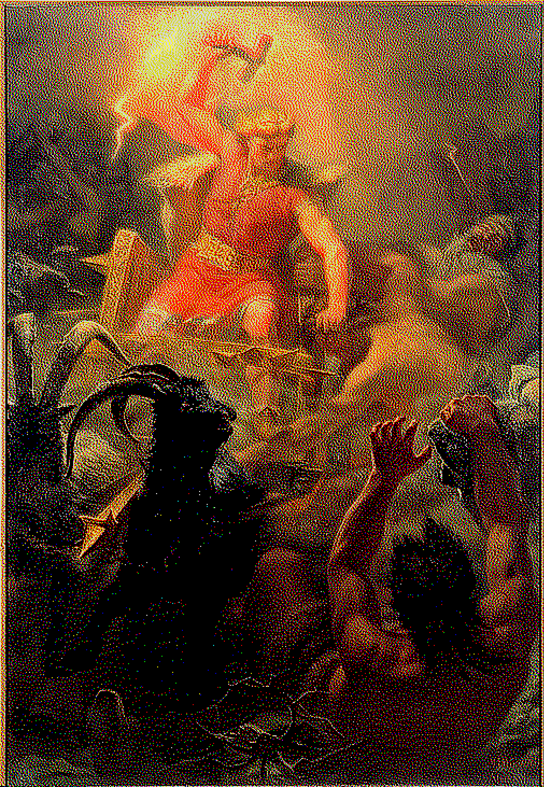
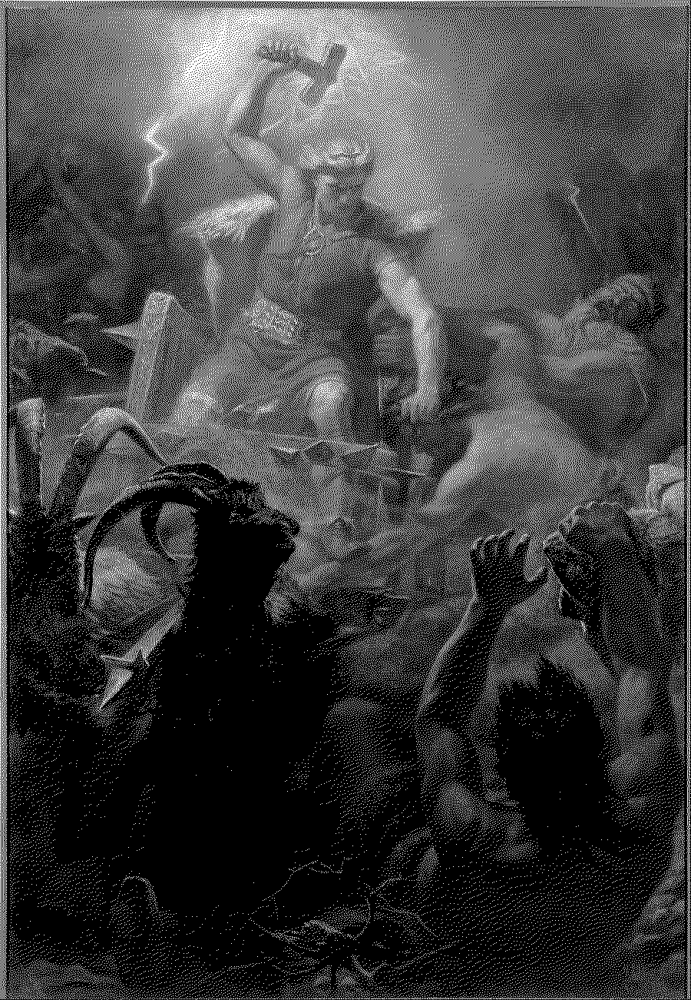
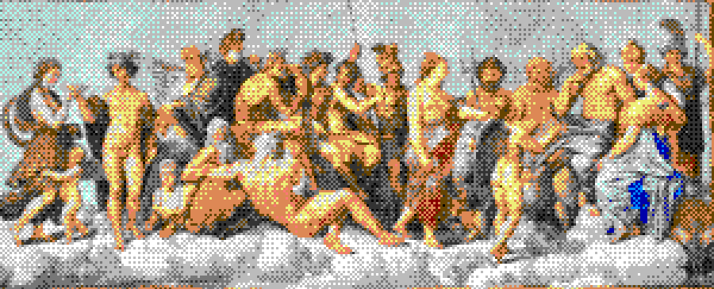
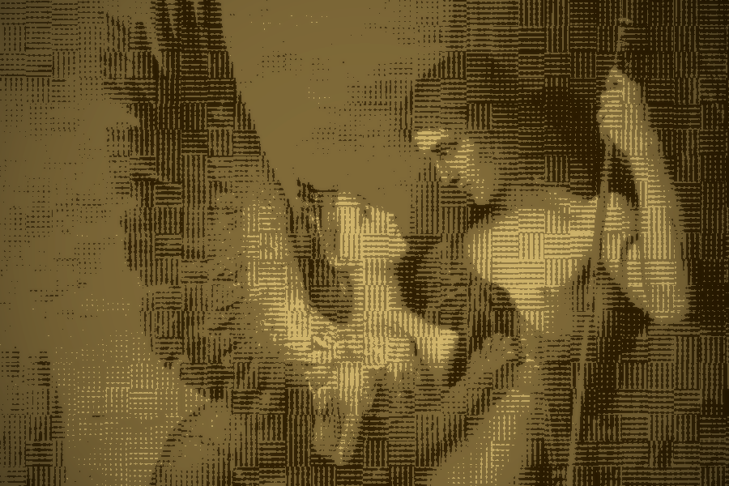
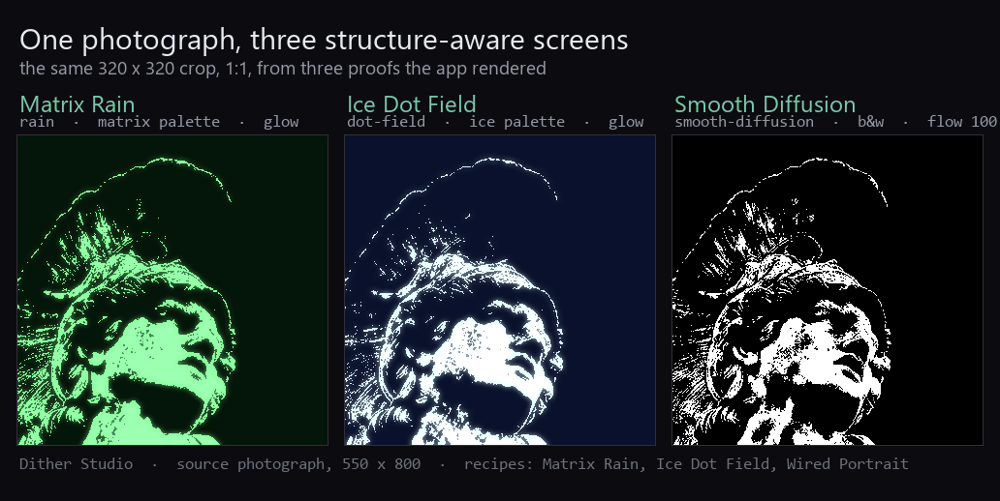
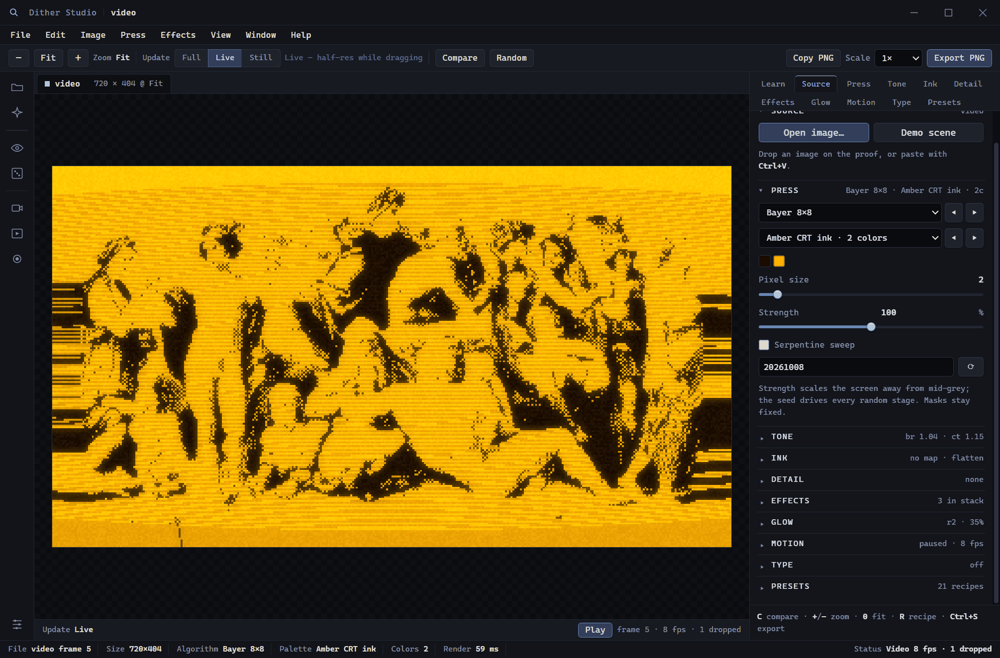

# Dither Studio

Dither Studio is an offline dithering workbench for images and video. Load a
picture or a clip, choose one of **46 dither algorithms** and one of **24 ink
sets**, grade the tone and detail, stack a few effects on top, and keep what
comes out — a PNG at up to 8×, the clipboard, a grid of text characters, a WebM
recording, or the recipe itself as JSON.

Everything runs on your machine. The web demo is a static page: no server, no
build step, no account. The desktop app reads and writes local files through the
operating system's own dialogs and makes no network request at all.

**Try the web demo** — <https://thijnperd.github.io/dither-studio/>, nothing to install.
**Download the desktop app** — [the latest release](https://github.com/thijnperd/dither-studio/releases/latest).
**Read the guides** — [GUIDE.md](GUIDE.md) walks the console, [desktop/GUIDE.md](desktop/GUIDE.md) the app window.


## What it does

- **46 algorithms.** Classic ordered screens (Bayer 2–16, clustered-dot,
  halftone, line and diagonal screens, checks), void-and-cluster, blue noise,
  IGN, R2, crosshatch, stochastic dithers, three Yliluoma colour-mixing plans,
  fourteen error-diffusion kernels, and three structure-aware screens that read
  the image's own contours instead of tiling over it.
- **24 ink sets.** 1-bit black and white, Game Boy, Game Boy Pocket, C64, NES,
  ZX Spectrum, CGA, EGA, Apple II, MSX, Macintosh II, Teletext, Virtual Boy,
  PICO-8, Gruvbox, three grey ramps, and six single-ink sets (amber, sepia,
  cyan, blueprint, matrix green, ice). In a colour mode every output pixel is
  exactly one of the palette's inks.
- **Tone, detail, ink.** Black and white point, gamma, brightness, contrast,
  saturation and hue; blur, unsharp mask and median denoise; and **11 tone
  maps** that re-ink a finished dither — so a 1-bit proof stays exactly two
  inks — including your own ink and paper.
- **13 effects in a stack.** Chromatic aberration, JPEG blocks, scanlines,
  grain, pixel sort, wave, drip, kaleidoscope, dead pixels, vignette, CRT
  bloom, ripple and starfield, added one at a time, reorderable, each with its
  own amount and mode — plus a blurred **glow** pass that adds in linear light.
- **Chunky pixels.** A pixel size of 1–16 box-averages the picture before
  dithering and upscales it without smoothing, for pixel-art output.
- **Text mode.** Print the proof as ASCII, blocks, shades, hex or binary, and
  export the grid as `.txt`.
- **Video.** A clip or the webcam through the whole press at 1–30 fps, with
  three temporal dither rules and WebM recording; a frame that overruns its
  slot is dropped rather than queued.
- **21 recipes.** Whole setups — algorithm, palette, grading, effects and glow
  — applied in one pick, from Newsprint and Halftone Noir to VHS Decay and the
  three structure-aware looks.
- **Any screen.** The console contracts for a phone or tablet instead of being
  redesigned: finger-sized controls, pinch-to-zoom on the proof, and a rail that
  collapses into one bar with a summary of the station in view.

## Made with Dither Studio

Every picture below came out of the app's own engine, and each caption names the
recipe that made it. These images are made by users of the app and can be used as an example of what can be made.


*Gustave Moreau, **Oedipus and the Sphinx** (1864), through the **Void Bloom**
recipe: a void-and-cluster screen at pixel size 1, the eight-grey ink set, a
cyanotype re-ink, a 3 px glow.*



*Mårten Eskil Winge, **Thor's Fight with the Giants** (1872), through
**Spectrum Loading**: Sierra error diffusion at pixel size 2 onto the ZX
Spectrum's fifteen inks.*

## Examples

A set of proofs built to be *rebuilt*: [`examples/`](examples/) holds twelve
pictures, each one drawn by the app from the paintings that ship inside it, with
the recipe recorded beside it. They come from the built-in sources that come pre-installed, so anyone who clones this repository can regenerate every one of
them with

```bash
node tools/make-examples.js
```

and land on the same files, byte for byte. [`examples/index.html`](examples/index.html)
shows the set as a contact sheet you can open straight from a clone — no server,
no network — and [`examples/README.md`](examples/README.md) lists it as a table
with every setting behind it.



*Winge, **Thor's Fight with the Giants** (1872), through the **Zine** preset:
Floyd–Steinberg diffusion into one bit.*



*Raphael's workshop, **The Council of the Gods** (1517–18), through **C64**: a
Bayer 8 screen on the Commodore 64's sixteen-colour palette.*



*Moreau, **Oedipus and the Sphinx** (1864), four greys under a blue-noise screen,
re-inked as gold leaf and lit from behind.*

## Structure-aware screens

Three of the algorithms build their screen *from the picture*: a noise field is
sampled along the image's own iso-luma contours and biased towards edges, so the
texture follows the shading instead of fighting it. One photograph, one crop,
three of the shipped recipes:



**Smoothness** (feature size), **Flow** (how far the screen stretches along
contours) and **Streak** (how far it runs vertically) push the screens around,
and each one's sample budget is bounded, so a large working image cannot make
the screen loop. The recipes are **Matrix Rain**, **Ice Dot Field** and **Wired
Portrait**; [GUIDE.md §5](GUIDE.md#5-the-three-structure-aware-looks) describes
what each does to a photograph.

## Video



A clip file or the webcam goes through the entire press — every algorithm,
palette, grade and effect — and the result can be recorded to WebM. The three
temporal rules decide what happens between frames: **freeze** holds the screen
still, **shimmer** re-seeds a stochastic screen each frame so it boils while the
tone holds, and **crawl** slides an ordered screen a pixel per frame. Video runs
on a working frame capped at 720 px on its longest side, and the readout stays
honest about it: a frame that overruns its slot is counted as dropped.

## Three builds, one engine

| Build | State | What it is for |
|---|---|---|
| [**Web demo**](https://thijnperd.github.io/dither-studio/) | frozen | Nothing to install: a static page published from [`demo/`](demo/) by GitHub Pages. The quickest way in. |
| [**Launcher**](launcher/) | frozen | The same console in a Chromium app window with a profile of its own, started by a script in the folder — no install, no registry entry. |
| [**Desktop app**](desktop/) | **active** | The real application: native menus and dialogs, a built-in tutorial, video and webcam, and proofs saved as files. Windows and macOS. |

All three share one engine, [`dither.js`](launcher/dither.js): DOM-free, copied
into the desktop build byte for byte, with a CI check that fails if the copy
drifts. The built-in sources, [`samples.js`](launcher/samples.js), travel the
same way, so every build opens on the same three paintings. The two web builds
are frozen on purpose — they are what people have links to — so all new work
lands in `desktop/`.

## Quick start

**In a browser.** Open <https://thijnperd.github.io/dither-studio/>. It opens on
a built-in sample, so there is something on the stage before you load anything:
three public-domain paintings travel with the app — Gustave Moreau's *Oedipus
and the Sphinx*, Mårten Eskil Winge's *Tor's Fight with the Giants* and *The
Council of the Gods* from the Villa Farnesina — and **Built-in source** steps
through them and comes round again. Drop a picture onto the proof, paste one,
or use
**Open image…** to bring your own.


**Desktop app.** From [the latest release](https://github.com/thijnperd/dither-studio/releases/latest):

| Platform | Files |
|---|---|
| Windows | `Dither-Studio-Setup-<version>.exe` installs it (per user, choose the folder, Start menu entry); `Dither-Studio-<version>-portable.exe` runs from anywhere without installing |
| macOS | `Dither-Studio-<version>-arm64.dmg` on Apple silicon, `-x64.dmg` on Intel: open the disk image and drag the app to Applications |

Neither build is signed, so each system will ask once — Windows SmartScreen
wants *More info ▸ Run anyway*, and macOS Gatekeeper wants a right-click ▸
*Open* the first time. A newer setup removes any older Dither Studio it finds;
presets, panel layout and tutorial progress in `%APPDATA%\Dither Studio` are
kept. A fresh install is met by the **tour**: the Learn panel comes forward with
the first lesson on screen, and **Skip**, **Exit** or `Escape` ends it for good —
*Help ▸ Take the Tour* brings it back whenever you want it.

**From this folder.** The launchers open the console in a Chromium app window
with a profile of its own, under `%LOCALAPPDATA%\Dither Studio`,
`~/Library/Application Support/Dither Studio` or
`~/.local/share/dither-studio` — never inside the repository. Nothing is
installed or registered, and deleting that profile resets the app.

| | |
|---|---|
| Windows | double-click [`launcher/Dither Studio.cmd`](launcher/Dither%20Studio.cmd) |
| macOS | double-click [`launcher/Dither Studio.command`](launcher/Dither%20Studio.command) (right-click ▸ *Open* the first time) |
| Linux | [`./launcher/dither-studio.sh`](launcher/dither-studio.sh), made executable once |
| Any browser | open [`launcher/index.html`](launcher/index.html) |
| Desktop, from source | `cd desktop && npm install && npm start` — Node 20 or newer, Electron the only runtime |

Keep `launcher/` together: the launchers look for `index.html` beside
themselves.

**Keys** (desktop app):

| | |
|---|---|
| `Ctrl+O` / `Ctrl+Shift+O` | open an image / a clip |
| `Ctrl+S` / `Ctrl+Shift+C` | save the proof as a PNG / copy it to the clipboard |
| `Ctrl+D` | the next built-in source: the three paintings, in turn |
| `Ctrl+R` / `Ctrl+Shift+R` | a fresh recipe / a new seed |
| `Ctrl+↑` `Ctrl+↓` | previous / next algorithm |
| `Ctrl+←` `Ctrl+→` | previous / next palette |
| `Ctrl+T` | print with characters |
| `Ctrl+=` `Ctrl+-` `Ctrl+0` | zoom in / out / fit |
| `F1` `F5` `F11` | the guide, reload, full screen |
| `C` (hold) · `+/−/0` · `R` | compare with the source, zoom and fit, a fresh recipe |

A file dropped on the proof loads it, and `Ctrl+V` pastes an image.
[desktop/GUIDE.md](desktop/GUIDE.md) covers the window, the menus, the tutorial
and troubleshooting; [GUIDE.md](GUIDE.md) covers every control, the catalogue
and the video rules.

## Exports and privacy

| What | How |
|---|---|
| PNG | **Export** at 1×, 2×, 4× or 8× the working resolution, nearest-neighbour, so the pixel grid stays crisp |
| Clipboard | **Copy PNG** puts the current proof on the system clipboard |
| Text | **Text mode** on, then **Export .txt** — the character grid itself |
| WebM | **Record** in video mode, which stops itself after 60 s |
| Recipe | **Presets → Export JSON** writes the current settings; importing merges them over the defaults |

Nothing leaves the machine. The web builds are static files — one page, one
stylesheet, three scripts, no analytics and no request to anywhere — so they
keep working from `file://`, from a share, or from the published site. The
desktop app reads and writes files only through the system's own dialogs, keeps
its state in its own profile folder, and talks to no server: no account, no
telemetry, no update check.

## Checks

```bash
node launcher/test.js                                        # 87 engine tests
bash tools/check.sh launcher/index.html --expect canvas       # a page in a real browser
node tools/check-examples.js                                 # examples/ against its own manifest
cd desktop && npm test && npm run smoke                       # 39 core and tour checks, then the window
```

The smoke run boots the real desktop app on a profile of its own, makes 76
checks and screenshots both windows. [DEVELOPMENT.md](DEVELOPMENT.md) has the
rest: the repository layout file by file, how the desktop shell and the startup
screen are built, how the generated [examples](examples/) set is rebuilt and
checked, the installer and the release workflow, and what every harness option
and environment variable does.

## Credits

Inspired by **Dither Boy** (Studio AAA, commercial) and by
[**dither-guy**](https://github.com/manoelpiovesan/dither-guy), an open-source
Python alternative whose pipeline shape — adjust, downscale, dither,
post-process — informed this one. The structure-aware screens follow the idea of
structure-aware halftoning and Cabral & Leedom's line-integral convolution; the
temporal rules are the classic temporal-dither choices made explicit. The
algorithms are the published classics, the palettes are hardware facts, and this
implementation is original JavaScript: no code was copied from any of them.
[SOURCES.md](SOURCES.md) records where every feature, table and palette came
from. Not affiliated with any project named here.

Dither Studio is © 2026 Thijn Köhne, under the [BSD 3-Clause licence](LICENSE).
