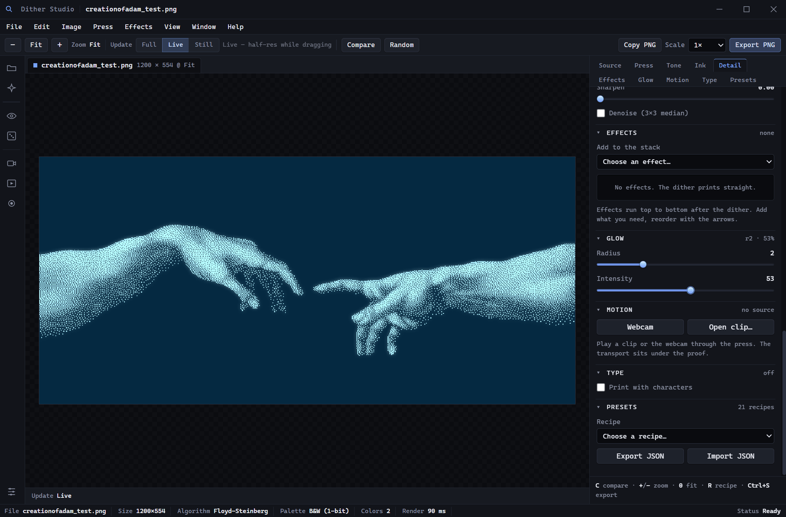
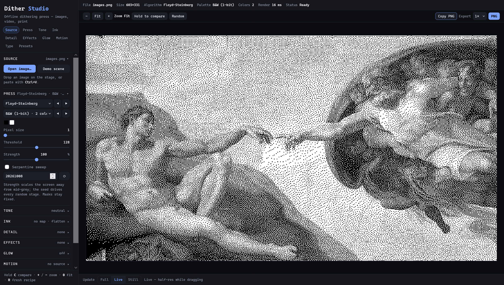
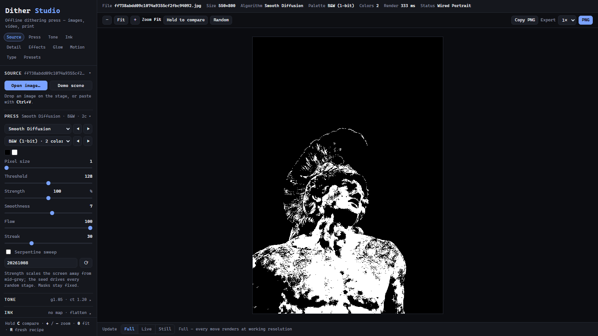
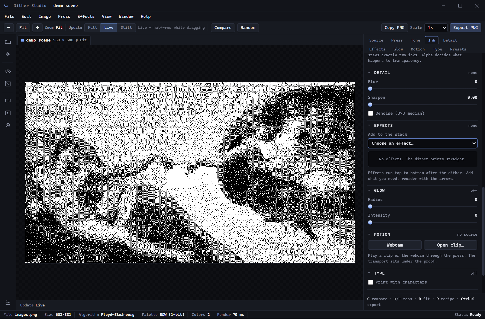
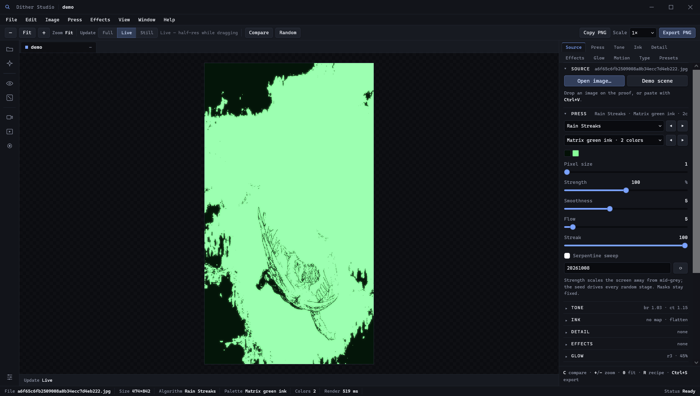
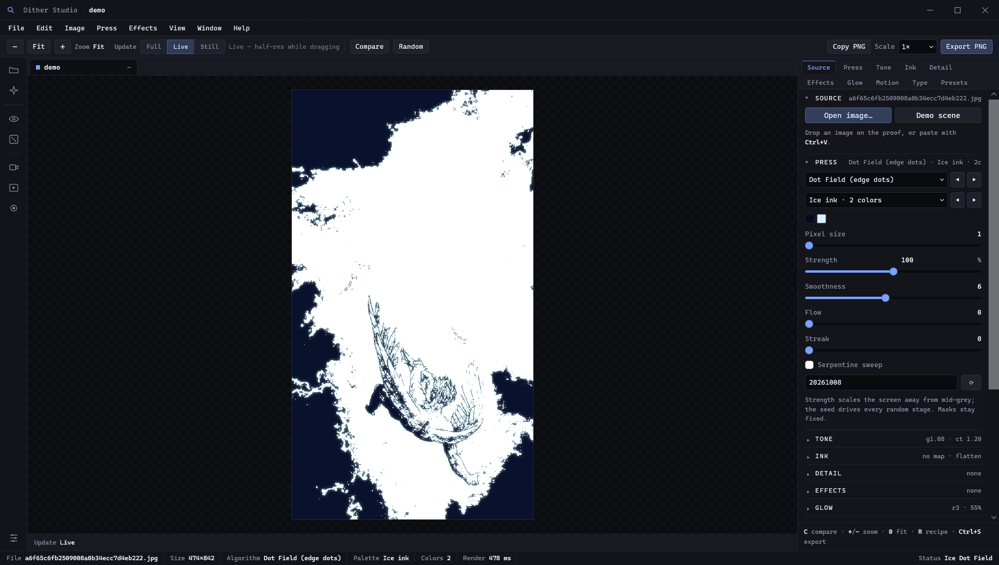
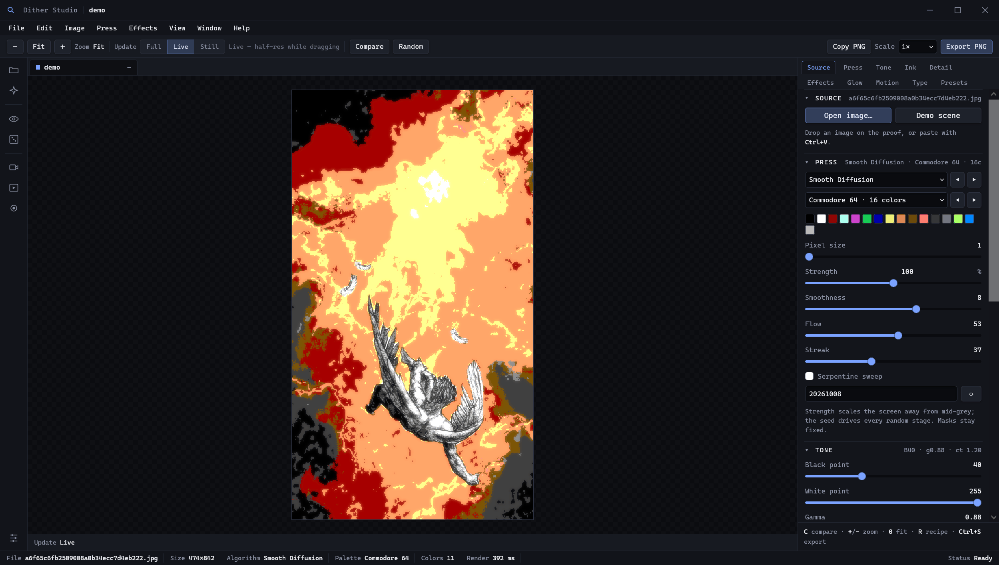

# Dither Studio

Dither Studio is a dithering workbench in one folder. Load an image or a
video, pick one of 46 dither algorithms and one of 24 palettes, grade the
picture, stack a few effects, and export the result — as a PNG, as a WebM
recording, or as a grid of text characters. It runs completely offline: no
build step, no server, no packages, nothing uploaded anywhere.

There are three ways to run it, and they all share one engine. The web demo
opens in any browser. The launchers put that same page in its own app window.
The desktop app is a real desktop application — Windows, and a macOS disk image
as of this release — with native menus, file dialogs and a built-in tutorial;
that's the one still being developed.



## Contents

| Start here | |
|---|---|
| **Use it now** | [the web demo](https://thijnperd.github.io/dither-studio/) — nothing to install |
| **Install the desktop app** | [the latest release](https://github.com/thijnperd/dither-studio/releases/latest) — the Setup or the portable `.exe` on Windows, the `.dmg` on macOS |
| **Run it from this folder** | [Run it](#run-it) — the launchers and the browser they use |
| **Learn the console** | [GUIDE.md](GUIDE.md) — the tour, station by station |
| **Learn the desktop window** | [desktop/GUIDE.md](desktop/GUIDE.md) |
| **Read the code** | [How it is put together](#how-it-is-put-together) · [Repository layout](#repository-layout) |
| **Check it** | [Verification](#verification) — the engine tests, the browser harness, the desktop smoke run |

Every section, in order:

- [Three builds, one engine](#three-builds-one-engine) — what is shared and what is frozen
- [Run it](#run-it) — the launchers and the browser they use
- [The desktop app](#the-desktop-app) — the active build, and how to run it
  - [Run it from source](#run-it-from-source)
  - [The window](#the-window)
  - [Keyboard](#keyboard)
  - [The tutorial](#the-tutorial)
  - [What is genuinely native](#what-is-genuinely-native)
  - [How it is put together](#how-it-is-put-together)
  - [Build the installer](#build-the-installer)
  - [The startup screen](#the-startup-screen)
  - [Performance](#performance)
- [What it does](#what-it-does) — the 46 algorithms, 24 palettes and the effects stack
  - [The three structure-aware looks](#the-three-structure-aware-looks)
- [Exports](#exports) — PNG, clipboard, text grid, WebM, recipe
- [Requirements](#requirements) — a browser; Node only for the tests and the desktop build
- [Repository layout](#repository-layout) — every folder and file
- [Verification](#verification) — the checks you can run here
  - [The engine, in Node](#the-engine-in-node)
  - [The page, in a real browser](#the-page-in-a-real-browser)
  - [The desktop app's own checks](#the-desktop-apps-own-checks)
- [Credits](#credits) — where the ideas and tables come from

## Three builds, one engine

| Build | Where | State | How you get it |
|---|---|---|---|
| **Web demo** | [`demo/`](demo/) | frozen | <https://thijnperd.github.io/dither-studio/> — published to GitHub Pages from `demo/` |
| **Launcher app** | [`launcher/`](launcher/) | frozen | the launchers: the page in an app-mode window with its own profile |
| **Desktop app** | [`desktop/`](desktop/) | **active** | the installer, or the `.dmg` on macOS, from [the latest release](https://github.com/thijnperd/dither-studio/releases/latest) |

What they share is `dither.js`, the dithering engine. It has no DOM
dependencies, it is copied into the desktop build byte for byte, and
`node desktop/tools/sync-renderer.js --check` (run by CI) fails if that copy
ever drifts. Everything else — the shells, the window chrome — belongs to one
build and is not shared.

The two web builds are frozen on purpose: they're what people have links to
and install from. `demo/` is also kept self-contained so the public Pages site
can never pick up desktop files. All new work happens in `desktop/`.

Just looking around? [GUIDE.md](GUIDE.md) is the tour of the console: running
it as an app, each station in the rail, the three structure-aware looks, video
mode, exports, keyboard shortcuts and troubleshooting. The desktop window has
its own tour in [desktop/GUIDE.md](desktop/GUIDE.md).

## Run it

| | |
|---|---|
| **Windows** | double-click **[`launcher/Dither Studio.cmd`](launcher/Dither%20Studio.cmd)** |
| **macOS** | double-click **[`launcher/Dither Studio.command`](launcher/Dither%20Studio.command)** (right-click → Open the first time, if Gatekeeper asks) |
| **Linux** | [`./launcher/dither-studio.sh`](launcher/dither-studio.sh) (make it executable once: `chmod +x launcher/dither-studio.sh`) |
| **Any browser** | open **[`launcher/index.html`](launcher/index.html)** |
| **Installed app** | open [`launcher/index.html`](launcher/index.html), then use the browser's *Install* / *Create shortcut* command (`manifest.webmanifest` makes this work) |
| **Desktop app** | [`desktop/`](desktop/), or the installer — or the `.dmg` on macOS — from [the latest release](https://github.com/thijnperd/dither-studio/releases/latest) |

The launchers look for Chrome, Edge, Brave or Chromium and open `index.html`
in app mode (`--app`) with a profile of the app's own, kept under
`%LOCALAPPDATA%\Dither Studio`, `~/Library/Application Support/Dither Studio`
or `~/.local/share/dither-studio` — never inside this folder. Nothing gets
installed or registered, and deleting that profile resets the app. If no
Chromium-family browser is found, the launcher falls back to opening
`index.html` in your default browser. Set `DITHER_DRY_RUN=1` to print the
command it would run instead of running it.

Keep `launcher/` together — the app *is* those files, and the launchers look
for `index.html` next to themselves.




## The desktop app

An Electron application with a window of its own: a caption bar it draws
itself, menus holding the whole catalogue, an options bar, a tool rail,
tabbed documents and a dock of panels. It opens images, clips and the webcam
through the operating system's own dialogs and saves proofs to real files, and
it teaches itself: the **Learn** panel runs ten lessons that walk the whole
press, one station at a time.

**Download:** [the latest release](https://github.com/thijnperd/dither-studio/releases/latest).
On Windows, take `Dither-Studio-Setup-<version>.exe` to install it, or
`Dither-Studio-<version>-portable.exe` to run it from anywhere without
installing. On macOS, take `Dither-Studio-<version>-arm64.dmg` on Apple silicon
or `-x64.dmg` on Intel, open the disk image and drag the app to Applications.
Running a newer setup removes any older Dither Studio it finds first, wherever
that one was installed. Neither build is signed, so both systems will ask once:
Windows SmartScreen wants *More info ▸ Run anyway*, and macOS Gatekeeper wants a
right-click ▸ *Open* the first time.

### Run it from source

```bash
cd desktop
npm install          # electron + electron-builder, the only dependencies
npm start            # opens the app
```

Node 20 or newer. The first `npm install` downloads Electron (about 100 MB);
after that the app starts in a second or two.

### The window



Every catalogue lives in the menus — all 46 algorithms, 24 palettes, 13
effects, 11 tone maps and 21 recipes, expanded from the app's own tables, so a
new algorithm can never be missing from a menu. The dock holds the eleven
panels as tabs, opening on **Learn**: the tutorial, and the one station that
starts open. The status bar carries the file, its size, the press, the colours and
the last render time. The note on the right of the caption bar is a receipt:
after a save it names the file, and clicking it opens the file's folder.
[desktop/GUIDE.md](desktop/GUIDE.md) walks through the window and the menus one
by one.

### Keyboard

| | |
|---|---|
| `Ctrl+O` / `Ctrl+Shift+O` | open an image / open a clip |
| `Ctrl+S` | save the proof as a PNG (native save dialog) |
| `Ctrl+Shift+C` | copy the proof to the clipboard |
| `Ctrl+D` | generated demo scene |
| `Ctrl+R` / `Ctrl+Shift+R` | roll a fresh recipe / new seed |
| `Ctrl+↑` `Ctrl+↓` | previous / next algorithm |
| `Ctrl+←` `Ctrl+→` | previous / next palette |
| `Ctrl+T` | print with characters |
| `Ctrl+=` `Ctrl+-` `Ctrl+0` | zoom in / out / fit in window |
| `F5` `F11` `F1` | reload the window, full screen, the guide |
| `Ctrl+Shift+I` | developer tools |
| `C` (hold) | compare with the source — the rail tool does the same |
| `+` `−` `0` `R` | zoom, fit, a fresh recipe |

A file dropped on the proof loads it; `Ctrl+V` pastes an image.

### The tutorial

The app teaches itself. A fresh install is met by the tour: the **Learn** panel
comes forward and the first lesson is already on screen, with **Skip** in the
corner of the card. Skip — or **Exit**, or `Escape` — ends it for good, and the
answer is remembered, so the tour never opens by itself again. After that
**Take the Tour** in the **Learn** panel, or *Help ▸ Take the Tour* in the menu
bar, starts it whenever you like; both bring the station back if it has folded
away.

Ten short lessons, one per station, from the first proof to the last export.
Each lesson is five or six steps, and each step dims the window, opens the panel
it is about, and settles a ring around the one control it means. If that control
is far down the rail, the rail is scrolled to it first, the way a guide turns the
page for you.

The learner does the work, not the app. The spotlight never takes a click, so
every control under it stays live; a step the app can check — an algorithm, a
palette, a recipe applied, text mode on — ticks itself off the moment the state
changes, and a step that cannot be checked simply says what to do. **Show me**
performs that one step for a stuck learner, **Back** and **Next** move, and
**Escape** leaves. Progress is kept per lesson and per step, so a lesson resumes
where it was left; **Reset** clears the ticks and puts the intro back on offer.

Finishing the last lesson is the end of it: the Learn station folds itself away
and the verdict card closes on its own a moment later, so a tutorial that has
been completed stops taking up the dock. Nothing is lost — *Help ▸ Take the
Tour* opens the station again, ticks and all.

The lessons are data ([src/tour-spec.js](desktop/src/tour-spec.js)): a title, a
body, a selector for the control, an optional panel to open, an optional command
and an optional predicate over the app's own state. Nothing in the tutorial
draws a second copy of a control, which is why a renamed panel or a retired verb
comes out as a failed test rather than as a lesson pointing at nothing. It also
costs nothing while idle: the card is placed once per step and once per state
change, never per frame.

### What is genuinely native

- **Open and save dialogs** are the operating system's, with filters for the
  formats the app actually writes. A save returns a path, and the caption bar
  shows it.
- **Files arrive as bytes, not as paths.** The main process reads the file and
  hands the renderer an `ArrayBuffer`; a `file://` image in a `file://` page is
  an opaque origin to Chromium, which would taint the canvas and kill
  `getImageData` — the whole engine.
- **The clipboard** is Electron's, so a copied proof is a real PNG on the
  system clipboard, ready to paste into anything.
- **One window per app**: a second launch focuses the running one, and image
  files can be opened *with* Dither Studio (`Ctrl+O` is not the only way in).
- **The application menu** is a real Electron menu, which is what gives macOS a
  menu bar. On Windows and Linux the window is frameless and draws its own menu
  bar, so the chrome binds those accelerators itself.

### How it is put together

| File | |
|---|---|
| [`electron/main.js`](desktop/electron/main.js) | the window, the splash, the native dialogs, the clipboard, the application menu, and the smoke harness (which runs on a profile of its own) |
| [`electron/preload.js`](desktop/electron/preload.js) | the only bridge to the OS — `window.ditherDesktop`, context-isolated, no Node in the renderer |
| [`electron/splash.html`](desktop/electron/splash.html) | the startup animation: **this is the file to replace** (see below) |
| [`electron/Splash/`](desktop/electron/Splash/) | the source PNGs the animation was built from (Adam, Adam dithered, God). The document inlines its own copies, so `build.files` keeps this folder out of the package |
| [`src/index.html`](desktop/src/index.html) | the window's markup: caption, menus, options, rail, document tabs, dock, status |
| [`src/menu-spec.js`](desktop/src/menu-spec.js) | the one menu definition, shared by the native menu and the drawn one |
| [`src/tour-spec.js`](desktop/src/tour-spec.js) | the tutorial's lessons, as data: a target selector, a body, an optional panel, an optional command and a `when` predicate per step |
| [`src/renderer/core.js`](desktop/src/renderer/core.js) | the desktop core: the colour pair, the catalogue lookups, the settings paths, the one dropdown builder |
| [`src/renderer/dither.js`](desktop/src/renderer/dither.js) | the engine — DOM-free, byte-identical to the web builds |
| [`src/renderer/video.js`](desktop/src/renderer/video.js) | the video source, clock and recorder |
| [`src/renderer/app.js`](desktop/src/renderer/app.js) | the desktop shell: rendering, controls, the native routes, and the command surface the menus drive |
| [`src/renderer/shell.js`](desktop/src/renderer/shell.js) | the chrome: menus, tool rail, caption, slider fills, window verbs |
| [`src/renderer/tour.js`](desktop/src/renderer/tour.js) | the tutorial's runner: the Learn panel's list, the coach mark, step navigation, Skip, the first-run intro and progress |
| [`src/styles/tokens.css`](desktop/src/styles/tokens.css) | tokens, the page grid, every element-level control |
| [`src/styles/chrome.css`](desktop/src/styles/chrome.css) | caption, menus, options bar, rail, document tabs, the well, the bars |
| [`src/styles/panels.css`](desktop/src/styles/panels.css) | the dock: panel tabs, fields, sliders, swatches, the effects stack |
| [`tools/sync-renderer.js`](desktop/tools/sync-renderer.js) | keeps `src/renderer/{dither,video}.js` byte-identical to the shared engine |
| [`tools/tour.test.js`](desktop/tools/tour.test.js) | the tutorial data's own suite: real panels, real commands, nothing already done on a fresh app |
| [`tools/smoke-in-page.js`](desktop/tools/smoke-in-page.js) | the page half of the smoke run |

The desktop shell is its own code. It used to be the web shell with ten
patches applied, which meant every helper existed twice, so the desktop now
has a core of its own (`src/renderer/core.js`) holding the shared helpers once.
What every build shares is the engine.

```bash
node tools/sync-renderer.js          # refresh the engine copies
node tools/sync-renderer.js --check  # fail if either has drifted (CI runs this)
node tools/core.test.js              # the core's own rules, in Node
```

### Build the installer

```bash
cd desktop
npm run build    # the checks, then dist/Dither-Studio-Setup-<version>.exe + the portable exe
npm run dist     # the Windows packaging step on its own, once the checks have run
npm run dist:mac # the macOS disk images, x64 and arm64 (run it on macOS)
npm run pack     # dist/win-unpacked/ only, much faster while iterating
```

`npm run build` is the local half of that workflow — the same checks in the same
order, then packaging (`node tools/build-checks.js`; `--skip-smoke` drops the
window-driven run when no desktop can be spared) — so a setup built here carries
what a released one does. It prints both executables and their sizes when it is
done.

You usually don't have to run this by hand: the **build** workflow on GitHub
builds both platforms for every push that touches the app — the setup and the
portable exe on a Windows runner, the x64 and arm64 disk images on a macOS one —
and checks the full code first (engine tests, desktop core tests, tour tests,
engine-copy sync, two smoke runs), so a broken commit is never packaged. Push a
`v<version>` tag, with `version` in `desktop/package.json` bumped to match, and a
third job attaches every artifact to that tag's GitHub release.

electron-builder writes an NSIS installer (per-user, choose the folder, Start
menu shortcut) and a portable single-file executable on Windows, and one
unsigned disk image per Mac architecture on macOS. The icon comes from
`build/icon.png`, the app's own dithered mark; keep it in step with
`icons/icon-512.png` in the repository root, which is the same 512 px proof.

Installing a newer setup removes the older ones first. electron-builder removes
the copy it knows about, under the app's own registry key in the install context
being used; [`desktop/build/installer.nsh`](desktop/build/installer.nsh),
compiled in through `nsis.include`, covers what that misses — a build installed
for all users and replaced by a per-user setup or the reverse, an install whose
folder was picked somewhere else the first time, and a row in *Apps & features*
whose files are already gone. It removes those files itself and never runs an
older build's uninstaller: that uninstaller works out its own folder from a
registry key and falls back to the default per-user folder, which is exactly
where the new setup is writing. In *Apps & features* it appears once, as
"Dither Studio", with the version beside it, and everything in
`%APPDATA%\Dither Studio` — presets, panels, tutorial progress — is kept.

### The startup screen

Adam's arm reaches in from the left, God's from the right. When the fingertips
touch, Adam is dithered — his own pre-screened image is revealed over the
painted one, spreading from the fingertip back along the arm — and starts to
glow; God stays painted. The wordmark inks in underneath and the window opens.

`electron/splash.html` is one self-contained document (inline style, inline
script, every image inlined as a data URI, nothing fetched from disk) and it is
meant to be replaced. Its header names the three parts to change: `HANDS`, the
three images and the fingertip inside each one; `T`, the whole schedule in
milliseconds; and the ink colour. The frames only blit — the three images
decode once, the light dots of the dithered one are recoloured to the ink once,
the glow is a single blurred copy built when the box is laid out, and every
frame after that only draws them. If you change the total, change
`SPLASH_MIN_MS` in `electron/main.js` (2900 ms) to match.

To look at a single frame while you work on it, hold the animation and shoot
it:

```bash
DITHER_SPLASH_MS=99999 DITHER_SPLASH_AT=2400 npm run smoke
# -> $DITHER_SMOKE_DIR/dither-splash.png, frozen at 2.4 s
```

### Performance

The desktop build inherits the engine's budget unchanged: the working image is
capped at 1600 px on its longest side, dragging a slider renders a half-res
preview on the next frame, and the full pass runs when the control is released.
The chrome adds nothing per frame — the only timer in the app polls a
recording flag twice a second. On a 1024² frame the heaviest algorithm stays in
the low seconds, which is the same number the web build reports.

## What it does

- **46 algorithms** — classic ordered screens, void-and-cluster and blue noise,
  stochastic dithers, Yliluoma colour mixing, fourteen error-diffusion kernels,
  and three **structure-aware** screens that read the image's own contours
  instead of tiling over it.
- **24 palettes** — 1-bit B&W, Game Boy, C64, NES, ZX Spectrum, CGA, Teletext,
  Apple II, MSX, Virtual Boy, PICO-8, EGA, Macintosh II, Gruvbox, four grey
  ramps and six single-ink sets (amber, sepia, cyan, blueprint, matrix green,
  ice). Colour modes snap every pixel to the palette, and every output pixel is
  exactly one of its inks.
- **Phone and iPad** — the same console, contracted rather than redesigned: a
  finger-sized layout, pinch-to-zoom on the proof, and a rail that collapses
  into one console bar with a live summary of the station in view.
- **Tone, detail, ink** — black/white point, gamma, brightness, contrast,
  saturation, hue; blur, unsharp mask, median denoise; eleven tone maps that
  re-ink the finished dither so 1-bit stays exactly two inks, including your
  own ink and paper.
- **Thirteen effects in a stack** — chromatic aberration, JPEG blocks, scanlines,
  grain, pixel sort, wave, drip, kaleidoscope, dead pixels, vignette, CRT bloom,
  ripple, starfield — added one at a time, reorderable, each with its own
  amount and mode. Plus a blurred **glow** pass in linear light.
- **Chunky pixels** — a pixel size of 1–16 box-averages the image before
  dithering and upscales it without smoothing, for pixel-art output.
- **Text mode** — print the proof as ASCII, blocks, shades, hex or binary, and
  export the grid as `.txt`.
- **Video** — a video file or the webcam through the whole press, 1–30 fps,
  three temporal dither rules, and WebM recording. A frame that overruns its
  slot is dropped rather than queued.
- **Exports** — PNG at 1×, 2×, 4× or 8× with nearest-neighbour scaling, copy to
  clipboard, the text grid, and the current recipe as JSON.

### The three structure-aware looks

Three screens built for photographs, all in the box as presets. They stretch a
noise field along the image's own iso-luma contours (a short line-integral
convolution along the gradient's tangent), then bias it towards edges, so the
screen follows shading instead of fighting it.

| Preset | Screen | Character |
|---|---|---|
| **Matrix Rain** | Rain Streaks | Stretches the screen vertically: midtones print as dot strings that run down the frame. |
| **Ice Dot Field** | Dot Field | Flats collapse toward a plain threshold while edges open up, so a subject prints as dots on clean paper. |
| *Smooth Diffusion* | Smooth Diffusion | A calm, wavy screen — the darkest and busiest of the three over a photo. |





Three sliders push them around — **Smoothness** (feature size), **Flow** (how
far the screen stretches along contours) and **Streak** (how far it runs
vertically) — and both reaches are bounded by a sample budget, so a large
working image cannot make the screen loop unbounded.

## Exports

| What | How |
|---|---|
| PNG | **Export** at 1×, 2×, 4× or 8× the working resolution, nearest-neighbour, so the pixel grid stays crisp |
| Clipboard | **Copy PNG** puts the current proof on the clipboard |
| Text | **Text mode** on, then **Export .txt** |
| WebM | **Record** in video mode (auto-stops at 60 s) |
| Recipe | **Presets → Export JSON** writes the current settings; importing merges them over the defaults |

## Requirements

A modern browser (Chrome, Edge, Brave, Firefox or Safari) is enough for the web
builds. A Chromium-family browser is only needed for the app-window launchers.
No Node, no Python, no package manager — Node is needed only to run the tests
or regenerate the icons, and the desktop build adds Node 20+ and its two dev
dependencies.

## Repository layout

| Path | What it is |
|---|---|
| [`launcher/`](launcher/) | the **launcher** build, self-contained: the page (`index.html`, `style.css`, `app.js`, `video.js`), the engine master (`dither.js`) and its tests (`test.js`), the three launchers, `manifest.webmanifest` and `icons/` |
| [`launcher/dither.js`](launcher/dither.js) | the engine: screens and masks, 46 algorithms, palettes, mixing plans, adjustments, tone maps, alpha, effects, glow, video temporal rules, `process()`. DOM-free, shared by all three builds |
| [`launcher/test.js`](launcher/test.js) | the engine's Node tests |
| [`launcher/Dither Studio.cmd`](launcher/Dither%20Studio.cmd), [`launcher/Dither Studio.command`](launcher/Dither%20Studio.command), [`launcher/dither-studio.sh`](launcher/dither-studio.sh) | the app-mode launchers (Windows / macOS / Linux) |
| [`launcher/manifest.webmanifest`](launcher/manifest.webmanifest), [`launcher/icons/`](launcher/icons/) | installable-app metadata and the generated mark |
| [`tools/make-icons.js`](tools/make-icons.js) | regenerates `launcher/icons/` through the app's own core |
| [`tools/inbox.js`](tools/inbox.js) | lists what is waiting in `inbox/`, with each capture's format, bytes and pixel size |
| [`tools/`](tools/) | optional browser-check harness (`check.sh`, `browser-check.cjs`); Playwright is a global tool, never a dependency |
| [`demo/`](demo/) | the **frozen** web demo published to GitHub Pages, favicon and icons included |
| [`desktop/`](desktop/) | the **active** Electron build, in its own folder with its own dependencies |
| [`docs/`](docs/) | the screenshots in this file and the guides |
| [`inbox/`](inbox/) | where a new capture waits to be developed into `docs/`; the folder ignores its own contents, so nothing dropped in it can reach a commit |
| [`.github/workflows/`](.github/workflows/) | `test.yml` runs the tests and the renderer-sync check; `build.yml` builds the Windows installer and the macOS disk images and publishes releases; `pages.yml` publishes `demo/` |
| [`README.md`](README.md) | this file — the front door for the whole repository |
| [`GUIDE.md`](GUIDE.md) | the tour: the console, the catalogue, video, exports, troubleshooting |
| [`desktop/GUIDE.md`](desktop/GUIDE.md) | the tour of the desktop window |
| [`SOURCES.md`](SOURCES.md) | where every feature, table and palette came from |

## Verification

Three layers of checks ship with the app.

### The engine, in Node

```bash
node launcher/test.js
```

The tests use Node's built-in `assert`; nothing needs installing. They cover
matrix generation and endpoint safety, void-and-cluster determinism, blue-noise
bounds, palette lookup, tone reproduction on flat patches, palette membership of
every output pixel, seeded determinism across all 46 algorithms, the
structure-aware screens, pixel chunking, settings clamping, the adjustments,
every effect and its modes, glow, tone maps, the three alpha modes, the video
temporal rules, and the performance budget — and they print the timings for the
1024×1024 pixel-size-1 budget, so a regression is visible even when the
generous cap still passes. CI runs the same command on Node 20 and 22.

### The page, in a real browser

`tools/` holds a small headless driver that loads a page, records console and
page errors, can press keys, click, assert selectors exist, evaluate JS and
screenshot. It prints a JSON summary and exits non-zero on any error or missing
`--expect`.

```bash
bash tools/check.sh launcher/index.html --expect canvas --screenshot /tmp/dither.png
```

| Option | Meaning |
|---|---|
| `--wait <ms>` | wait after load before checking (default `1000`) |
| `--size <WxH>` | viewport size (default `1000x700`) |
| `--expect <sel>` | fail unless the selector exists (repeatable) |
| `--press <key>` | press a key after load, e.g. `c`, `0`, `r` (repeatable) |
| `--click <sel>` | click an element after load (repeatable) |
| `--screenshot <file>` | save a PNG of the final state |
| `--eval <js>` | evaluate JS in the page and print the result |
| `--headed` | show a real window (default: headless) |

A local path is turned into a `file://` URL automatically. `check.sh` is a
wrapper that points `NODE_PATH` at the global npm root; `browser-check.cjs`
also falls back to `npm root -g` itself, so the wrapper is a convenience, not a
requirement. It needs Playwright installed **globally**, so the app stays
dependency-free:

```bash
npm install -g playwright
playwright install chromium
```

The page exposes `window.__dither`, so a check can set a recipe, run a preset
or step through video frames without clicking anything:

```bash
# what the app currently reports
bash tools/check.sh launcher/index.html --eval "JSON.stringify(window.__dither.stats())"

# a preset, then the inks actually drawn on the canvas
bash tools/check.sh launcher/index.html --eval \
  "window.__dither.applyPreset('matrixrain'); window.__dither.canvasColors()"

# the console: station state, the effects stack, the update mode
bash tools/check.sh launcher/index.html --eval "(function(){ var d = window.__dither; \
  d.addEffect('scanlines'); d.addEffect('grain'); d.moveEffect(1, -1); \
  return { stack: d.activeEffects(), quality: d.setQuality('still'), \
           groups: d.groups().length, swatches: d.swatches().length }; })()"

# video, with no file and no camera: the generated clip drives real frames
bash tools/check.sh launcher/index.html --eval \
  "JSON.stringify(window.__dither.videoSynthetic(480, 320))"
```

Run from the repository root so `launcher/index.html` resolves, and note that the
harness takes only the last `--eval` — chain multi-step checks inside one
(async) expression. `ok` is `true` only when there are no console errors, no
page errors and every `--expect` matched. [GUIDE.md](GUIDE.md) describes what
the app should do when you drive it, and lists every hook.

### The desktop app's own checks

```bash
cd desktop
npm test                                       # the core and the tutorial: 39 checks, no window
npm run smoke                                  # boot, check, screenshot, exit 0/1
```

`npm test` runs both Node suites. `tools/core.test.js` covers the colour round
trip, the catalogue lookups the steppers and the menus share, the settings
paths, the station notes and the dropdown builder; `tools/tour.test.js` covers
the tutorial's lesson data, and it reads `app.js` itself for the command names
and panel ids, so a lesson cannot outlive the verb it drives. Neither suite needs
a window.

`npm run smoke` is `electron . --smoke --smoke-script tools/smoke-in-page.js`.
`--smoke` loads the real app and waits for it to signal ready, `--smoke-script`
evaluates that file in the page, then the harness prints one JSON report and
exits non-zero on any console error, page error, failed check or failed command
— the page's own verdict is part of the run's, not a footnote beside it. It also
photographs both windows into `$DITHER_SMOKE_DIR`: the splash window shoots
itself as its animation reaches the wordmark (it is over in under three
seconds, so waiting for the page checks to finish would miss it), and the app
window is shot at the end. The run also gets a profile of its own, deleted
before it starts, so it always meets the app the way a fresh install does — the
presets, panels and tutorial progress on the machine running it are untouched.

The current run makes 76 checks: the chrome exists, the catalogues fill their
lists, every slider is painted, the menus draw, their submenus expand to the
full catalogue and stay open while the pointer is on one of their rows, all 33
command names are wired, the effects stack is the real markup, panels answer to
their own verbs, and **a key press runs exactly one command**. The tutorial is
checked the same way: every one of its lessons points at a control that exists
and names a command that is wired, starting a lesson puts the ring over the
named control (measured against that control's own box), Next and Back move one
step at a time, **Show me** performs the step and the card ticks itself off once
the app agrees, a row the app is hiding is pointed at through the panel around
it, the rail is scrolled until that panel is on screen, Escape leaves, and
finishing a lesson records it and offers the next one. The new behaviour is held
to the same bar: an install that has never run the tour is met by it with Skip on
the card, Skip is remembered and folds the Learn station away with it, *Take the
Tour* brings that station back, and finishing every lesson folds the station away
and closes the card without waiting to be dismissed.

Environment variables let it exercise the parts a page cannot reach:

| Variable | What it does |
|---|---|
| `DITHER_SMOKE_DIR` | where the screenshots go (default: the temp directory) |
| `DITHER_SMOKE_SAVE=<path>` | answer every save dialog with this path — how the export chain is proved end to end |
| `DITHER_SMOKE_OPEN=<path>` | answer every open dialog with this file |
| `DITHER_SMOKE_MENU='File/Save Proof as PNG'` | click that native menu item, then report whether a file landed |
| `DITHER_SMOKE_KEY=ctrl+s` | send that key through the window's input pipeline (`DITHER_SMOKE_KEY_BEFORE=1` to press before the page script) |
| `DITHER_SMOKE_REPORT=<path>` | also write the JSON report to a file — the only way to read the verdict of a packaged `.exe`, which has no console |
| `DITHER_SPLASH_MS=<ms>` | keep the splash up this long, to photograph it |
| `DITHER_SPLASH_AT=<ms>` | hold the splash animation on that one frame — how each stage was checked and how `docs/desktop-splash.png` was taken |
| `DITHER_NO_SPLASH=1` | skip the splash entirely |

```bash
# the whole export chain: a simulated Ctrl+S, then proof the file exists
DITHER_SMOKE_SAVE=/tmp/proof.png DITHER_SMOKE_KEY=ctrl+s npm run smoke

# the native menu drives the app
DITHER_SMOKE_SAVE=/tmp/menu.png DITHER_SMOKE_MENU='File/Save Proof as PNG' npm run smoke
```

The same harness runs against a packaged build, which is the only way to check
what actually shipped. Give the script an absolute path there: a portable
executable unpacks into its own temporary folder and runs with that as its
working directory.

```bash
DITHER_SMOKE_REPORT=/tmp/report.json DITHER_SMOKE_SAVE=/tmp/proof.png \
  DITHER_SMOKE_KEY=ctrl+s ./dist/Dither-Studio-<version>-portable.exe --smoke \
  --smoke-script "$PWD/tools/smoke-in-page.js"
```

## Credits

Inspired by **Dither Boy** (Studio AAA, commercial) and by
[**dither-guy**](https://github.com/manoelpiovesan/dither-guy), an open-source
Python alternative whose pipeline shape (adjust → downscale → dither →
post-process) informed this one. The structure-aware screens are built on the
idea of structure-aware halftoning and Cabral & Leedom's line-integral
convolution; the temporal rules are the classic temporal-dither choices made
explicit. No code was copied from any of these projects: the algorithms are the
published classics, the palettes are hardware facts, and this implementation is
original JavaScript. See [`SOURCES.md`](SOURCES.md) for the provenance of every
feature and constant. Not affiliated with any project named here.

---

[↑ Back to the contents](#contents)
