# Examples

Twenty-five proofs, every one of them drawn by Dither Studio itself.

Each picture here came out of the app: the generator opens the real build in a
browser, loads one of the three paintings that ship inside it, applies the recipe
through the same calls the panels make, and saves the pixels the engine drew.
Nothing is a mock-up and nothing was retouched afterwards. Because the sources are
the app's own built-in pictures, a fresh clone can rebuild the whole folder — the
showcases in the [README](../README.md) come from photographs in `inbox/`, which is
not committed, and these do not depend on it.

**Open [index.html](index.html) in a browser** to see them as a contact sheet, each
one beside the recipe behind it and a link to the file at full size. It is one plain
file with no server and no network in it, so it opens straight from a clone.

Find what you came for:

- **What the algorithms do** — `oedipus-newsprint.png` is an ordered screen, the
  diffusion family is in `thor-zine-1bit.png`, and the error-free mixing algorithms
  are `council-yliluoma-ega.png`.
- **A whole look, one pick** — the eight `preset:` rows are the presets the app
  ships with, taken exactly as the Presets panel applies them.
- **Stacked effects** — `thor-vhs-decay.png` runs the entire effects stack at once.
- **Type mode** — `oedipus-text-mode-ascii.png` is the proof set in characters, the
  grid the `.txt` and `.html` exports carry. The ramp is a choice: ASCII here, and
  Blocks, Shades, Hex or Binary in the Text panel.
- **Hardware palettes** — the C64's sixteen inks, the Game Boy's four, and the
  EGA's sixteen, all in a palette the size of a postcard.
- **0.3.0 palettes and effects** — **Sweetie 16**, **Endesga 16** and **Nord**
  are on the shelf, alongside the **Oxide** and **Selenium** tone maps, tape
  tracking, channel roll, a kaleidoscope, a starfield and a slow swirl. The new
  proofs are cropped to the paintings' faces, hands and wings rather than shown
  whole, and each recipe records the crop.

## The set

<!-- examples:begin -->
| Picture | File, source and recipe | Drawn as | What it shows |
|---|---|---|---|
| [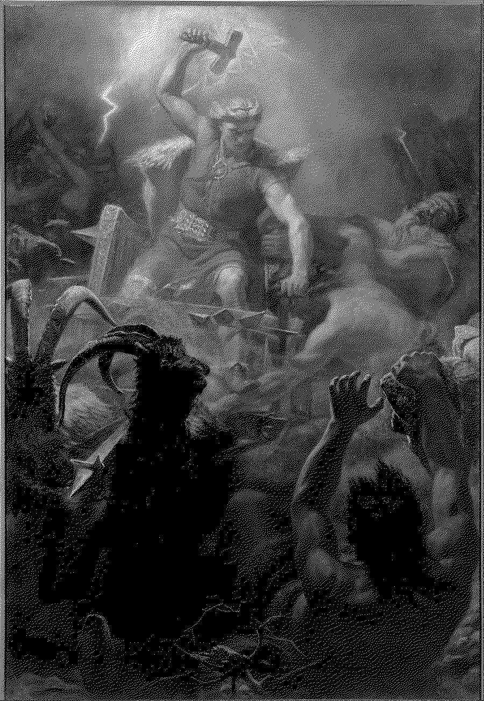](thor-zine-1bit.png) | **`thor-zine-1bit.png`**<br>Tor's Fight with the Giants<br>preset `zine` | floyd-steinberg · bw · 2 colours · 900×1301<br>496 KB | Floyd–Steinberg diffusion into one bit, the honest photocopied zine |
| [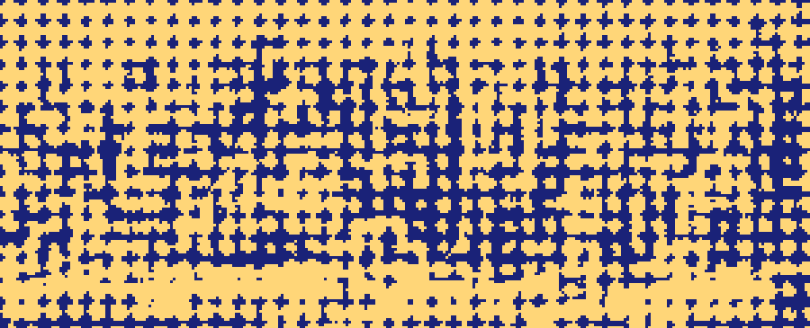](council-riso-duotone.png) | **`council-riso-duotone.png`**<br>The Council of the Gods<br>preset `duo` | clustered-dot-8 · bw · 2 colours · 900×365<br>23 KB | two inks and nothing else, the duotone a riso poster is built on |
| [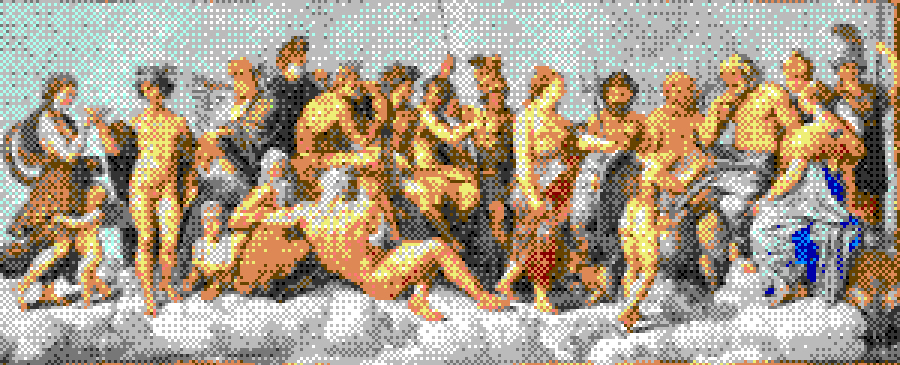](council-c64-poster.png) | **`council-c64-poster.png`**<br>The Council of the Gods<br>preset `c64` | bayer8 · c64 · 14 colours · 900×365<br>57 KB | the Commodore 64's own sixteen colours, a poster forty years late |
| [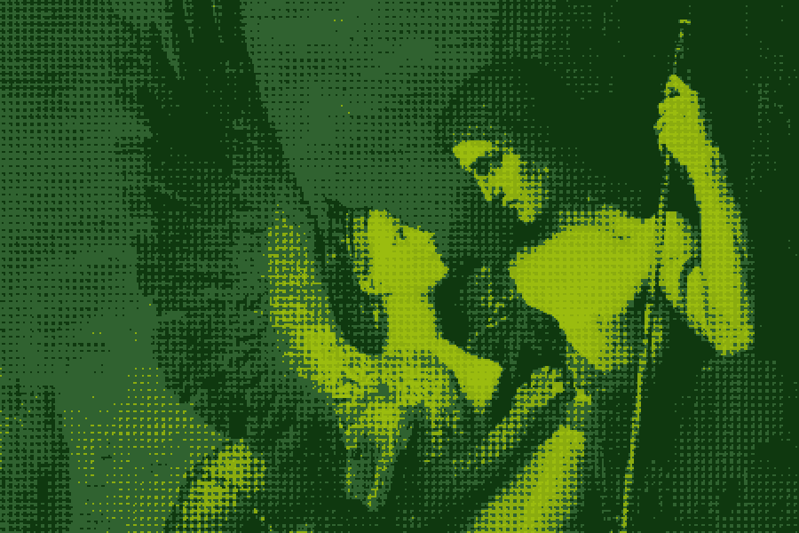](oedipus-terminal-green.png) | **`oedipus-terminal-green.png`**<br>Oedipus and the Sphinx<br>preset `terminal` | clustered-dot · gameboy · 4 colours · 900×600<br>82 KB | a phosphor re-ink on a four-shade screen, with scanlines over the top |
| [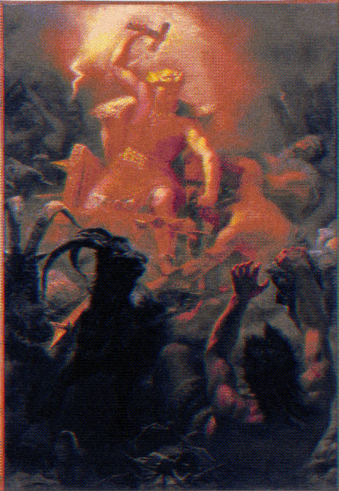](thor-vhs-decay.png) | **`thor-vhs-decay.png`**<br>Tor's Fight with the Giants<br>preset `vhs` | bayer4 · pico8 · 90730 colours · 900×1301<br>1135 KB | the whole effects stack at once - aberration, blocks, scanlines and grain |
| [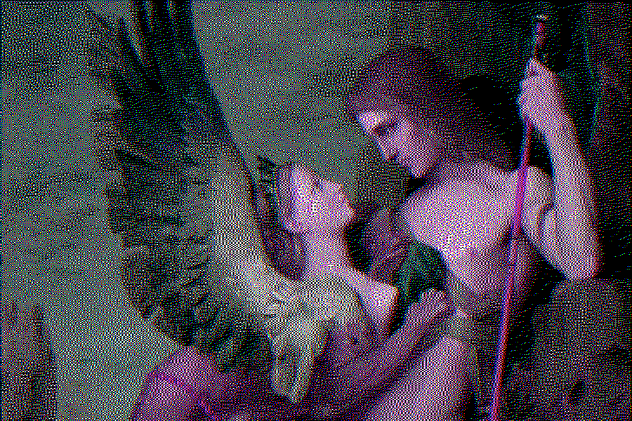](oedipus-glitch-sort.png) | **`oedipus-glitch-sort.png`**<br>Oedipus and the Sphinx<br>preset `sort` | floyd-steinberg · cga · 18 colours · 900×600<br>604 KB | pixel sorting - rows of the proof reordered by tone instead of drawn in place |
| [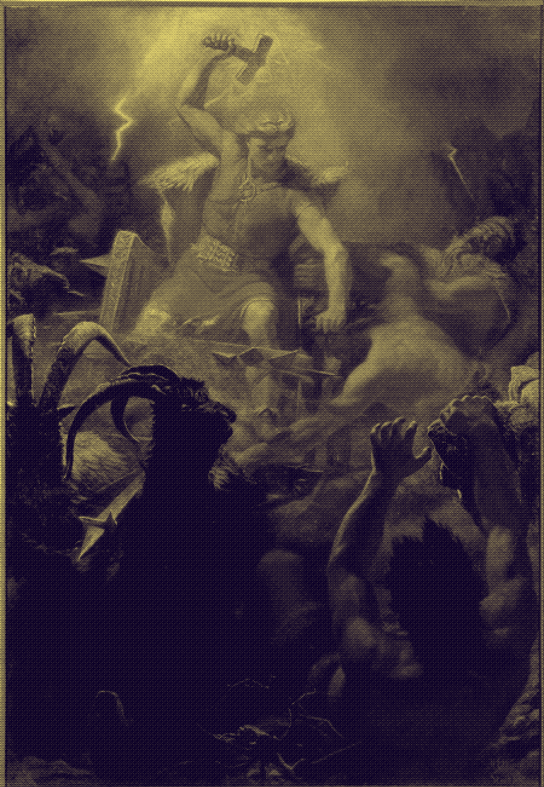](thor-thermal-cam.png) | **`thor-thermal-cam.png`**<br>Tor's Fight with the Giants<br>preset `thermal` | bayer16 · gray-16 · 16 colours · 900×1301<br>361 KB | a thermal re-ink: the grade decides what is hot, the dither decides the edges |
| [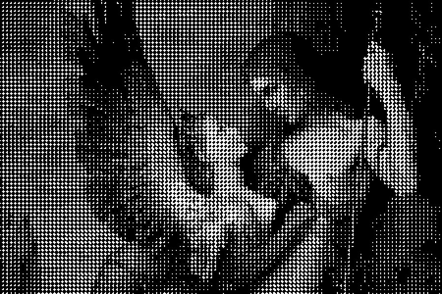](oedipus-newsprint.png) | **`oedipus-newsprint.png`**<br>Oedipus and the Sphinx<br>preset `newsprint` | halftone · bw · 2 colours · 900×600<br>58 KB | a halftone screen - an ordered dot at every pixel size, no noise anywhere |
| [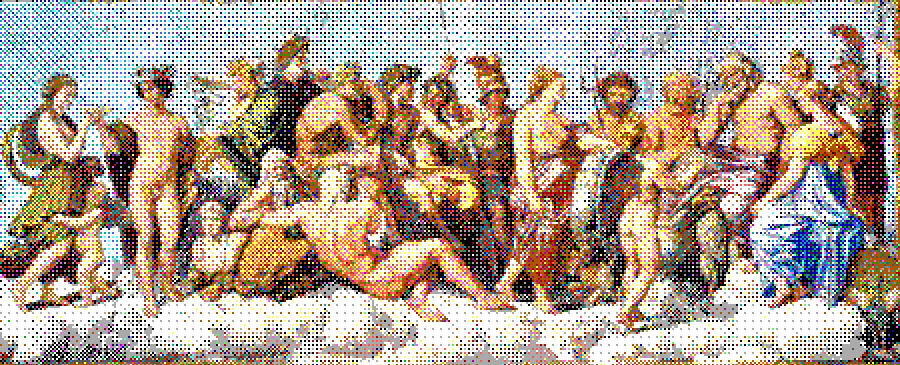](council-yliluoma-ega.png) | **`council-yliluoma-ega.png`**<br>The Council of the Gods<br>`yliluoma-polished` · `ega` · pixel size 2 | yliluoma-polished · ega · 16 colours · 900×365<br>162 KB | Yliluoma mixing: a sixteen-colour hardware palette, blended in dots rather than snapped |
| [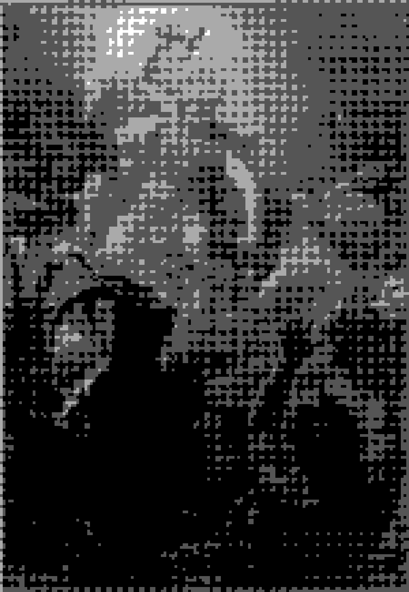](thor-pixel-art-6x.png) | **`thor-pixel-art-6x.png`**<br>Tor's Fight with the Giants<br>`clustered-dot` · `gameboy-pocket` · pixel size 6 | clustered-dot · gameboy-pocket · 4 colours · 900×1301<br>49 KB | pixel size 6 on a four-ink handheld screen - the chunky output people come for |
| [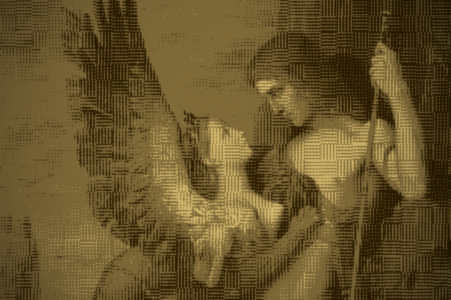](oedipus-gold-leaf.png) | **`oedipus-gold-leaf.png`**<br>Oedipus and the Sphinx<br>`blue-noise-32` · `gray-4` · tone `gold` · pixel size 1 · effects: vignette 45 · glow 2/40 | blue-noise-32 · gray-4 · 1906 colours · 900×600<br>637 KB | four greys under a blue-noise screen, re-inked as gold leaf and lit from behind |
| [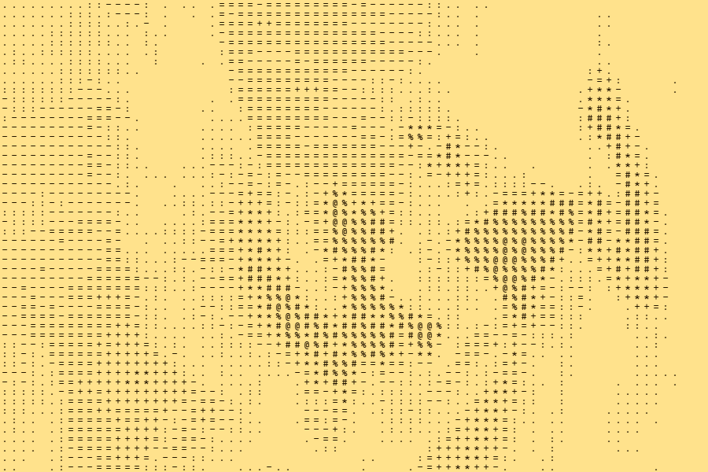](oedipus-text-mode-ascii.png) | **`oedipus-text-mode-ascii.png`**<br>Oedipus and the Sphinx<br>`atkinson` · `bw` · pixel size 1 · type mode, `ascii` at 12px | atkinson · bw · 95 colours · 900×600<br>76 KB | type mode: the same proof set in characters, the grid the .txt export carries |
| [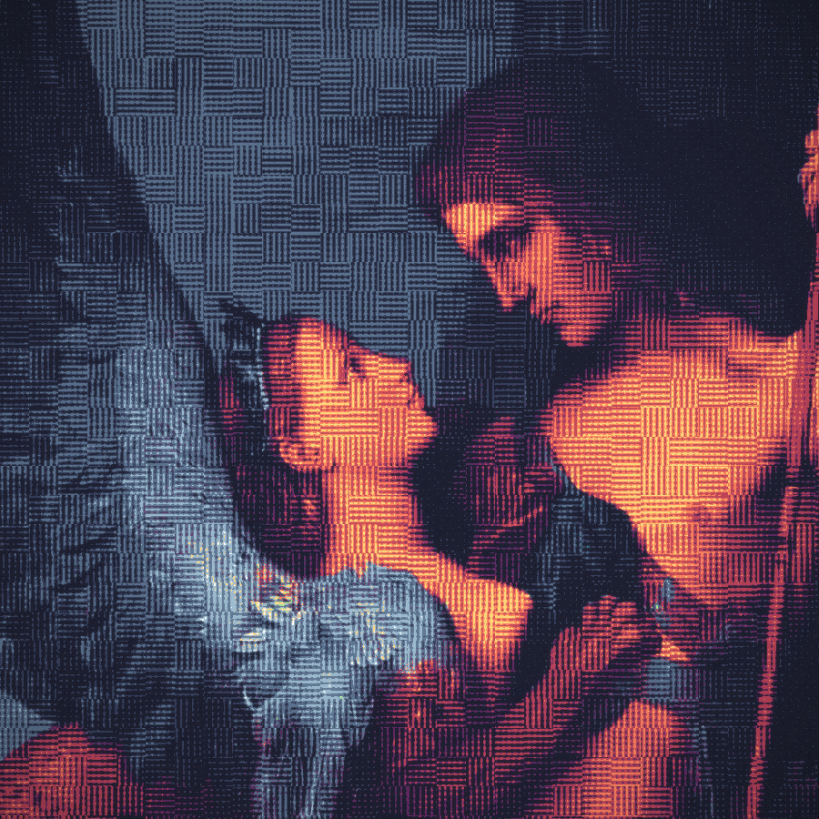](oedipus-sweetie-16.png) | **`oedipus-sweetie-16.png`**<br>Oedipus and the Sphinx<br>`blue-noise-32` · `sweetie-16` · pixel size 1 · crop 25%/5%/58%/88% · contrast 1.15 · saturation 1.1 · effects: vignette 32, grain 8 · glow 2/20 | blue-noise-32 · sweetie-16 · 18869 colours · 900×900<br>1739 KB | Sweetie 16 in a blue-noise proof: pastel skin, cobalt wing, a soft bloom |
| [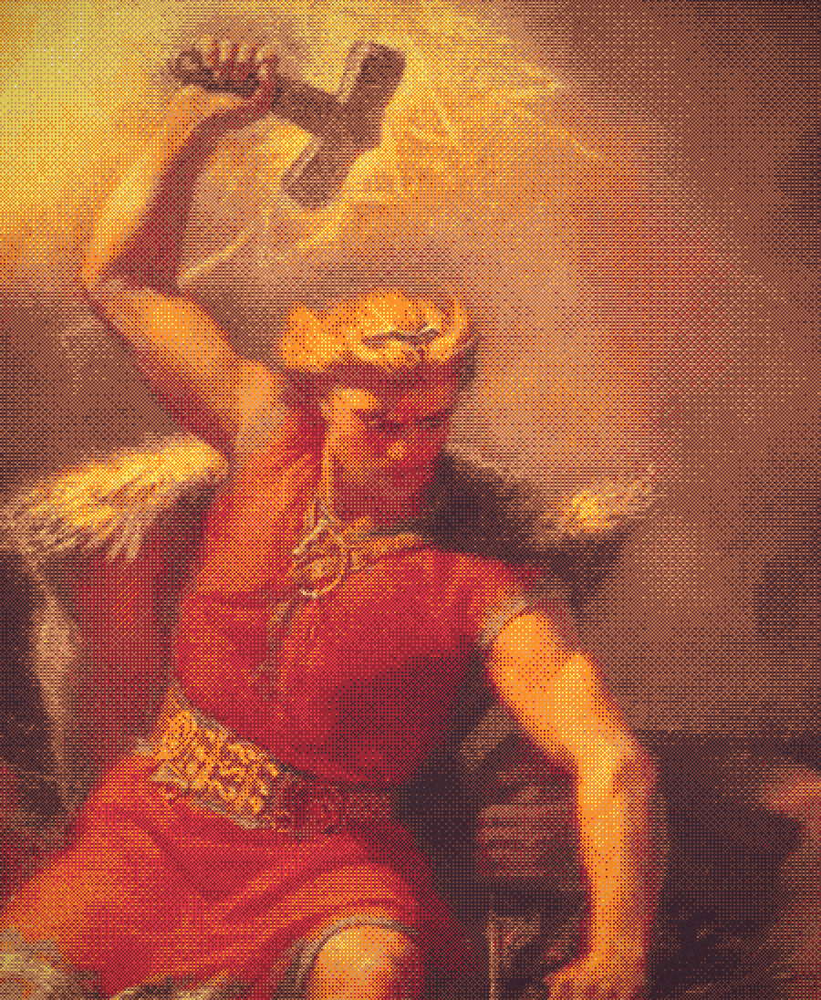](thor-endesga-strike.png) | **`thor-endesga-strike.png`**<br>Tor's Fight with the Giants<br>`bayer8` · `endesga-16` · pixel size 2 · crop 28%/3%/46%/38% · contrast 1.35 · brightness 0.92 · saturation 1.25 · effects: vignette 28, grain 8 | bayer8 · endesga-16 · 3100 colours · 900×1096<br>768 KB | Endesga 16 under the hammer: a saturated ordered screen for Thor's strike |
| [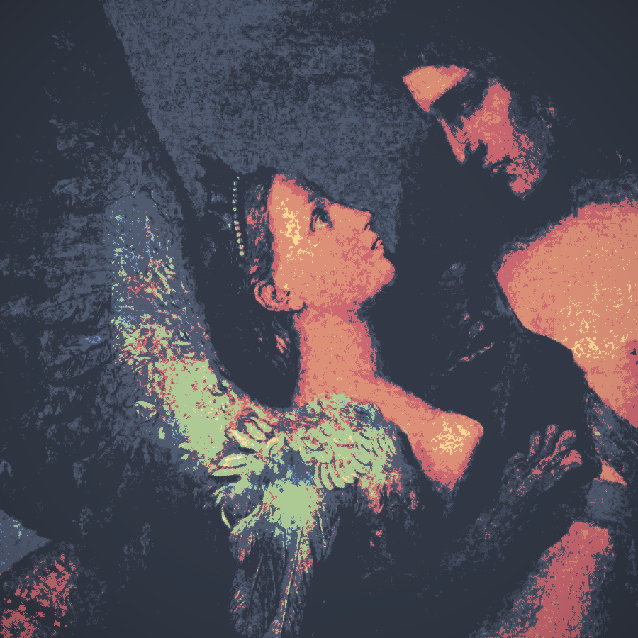](oedipus-nord-riddle.png) | **`oedipus-nord-riddle.png`**<br>Oedipus and the Sphinx<br>`smooth-diffusion` · `nord` · pixel size 1 · crop 25%/19%/50%/75% · contrast 1.22 · brightness 1.04 · saturation 0.85 · effects: vignette 25 · glow 1/15 | smooth-diffusion · nord · 6445 colours · 900×900<br>831 KB | Nord cools the meeting of Oedipus and the Sphinx to marble and teal |
| [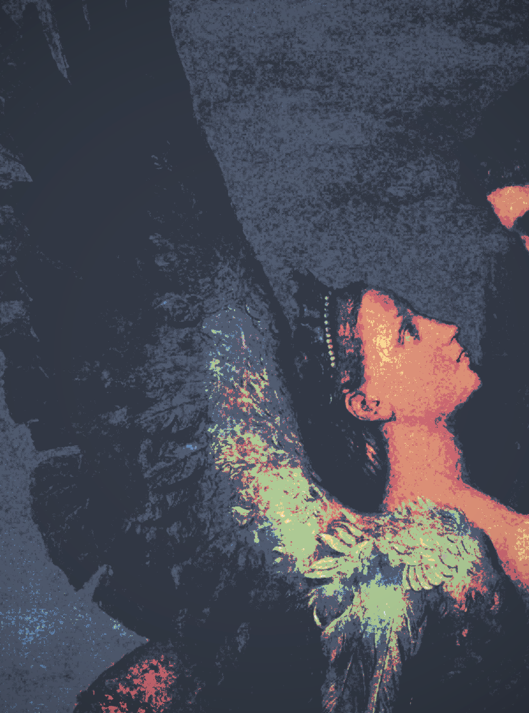](oedipus-nord-wing.png) | **`oedipus-nord-wing.png`**<br>Oedipus and the Sphinx<br>`smooth-diffusion` · `nord` · pixel size 1 · crop 17%/4%/43%/88% · contrast 1.25 · brightness 1.05 · saturation 0.85 · effects: vignette 25 · glow 1/15 | smooth-diffusion · nord · 7978 colours · 900×1212<br>1090 KB | the Sphinx's wing in Nord, close enough to count the feathers |
| [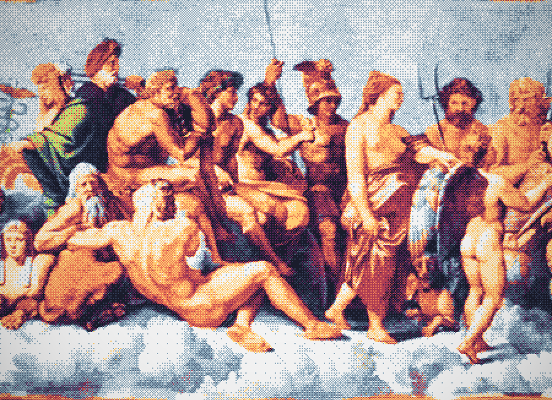](council-sweetie-16.png) | **`council-sweetie-16.png`**<br>The Council of the Gods<br>`bayer8` · `sweetie-16` · pixel size 2 · crop 22%/0%/56%/100% · contrast 1.3 · saturation 1.15 · effects: vignette 25 | bayer8 · sweetie-16 · 604 colours · 900×653<br>302 KB | Sweetie 16 turns the Council of the Gods into a pastel postcard |
| [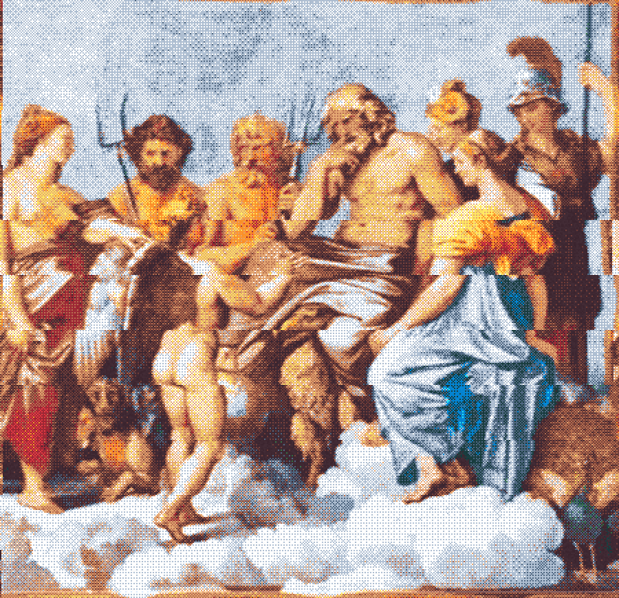](council-endesga-court.png) | **`council-endesga-court.png`**<br>The Council of the Gods<br>`bayer8` · `endesga-16` · pixel size 2 · crop 58%/0%/42%/100% · contrast 1.25 · saturation 1.15 · effects: tracking 30, grain 10 | bayer8 · endesga-16 · 179 colours · 900×870<br>474 KB | Endesga 16 on the right-hand court, with a strip of tape tracking |
| [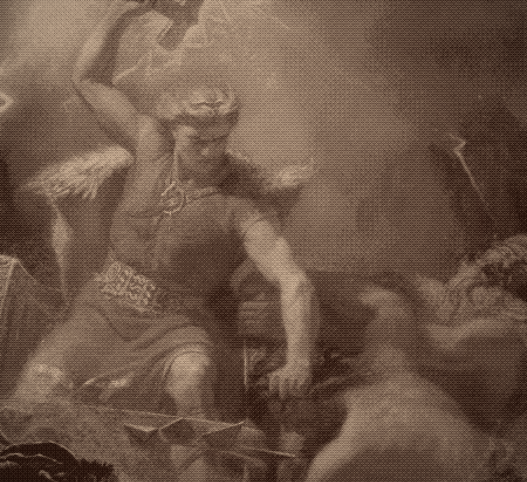](thor-oxide-rust.png) | **`thor-oxide-rust.png`**<br>Tor's Fight with the Giants<br>`bayer8` · `gray-8` · tone `oxide` · pixel size 2 · crop 23%/6%/69%/44% · contrast 1.35 · effects: vignette 30 | bayer8 · gray-8 · 518 colours · 900×823<br>358 KB | Oxide re-inks Thor and the giant as a rusted engraving |
| [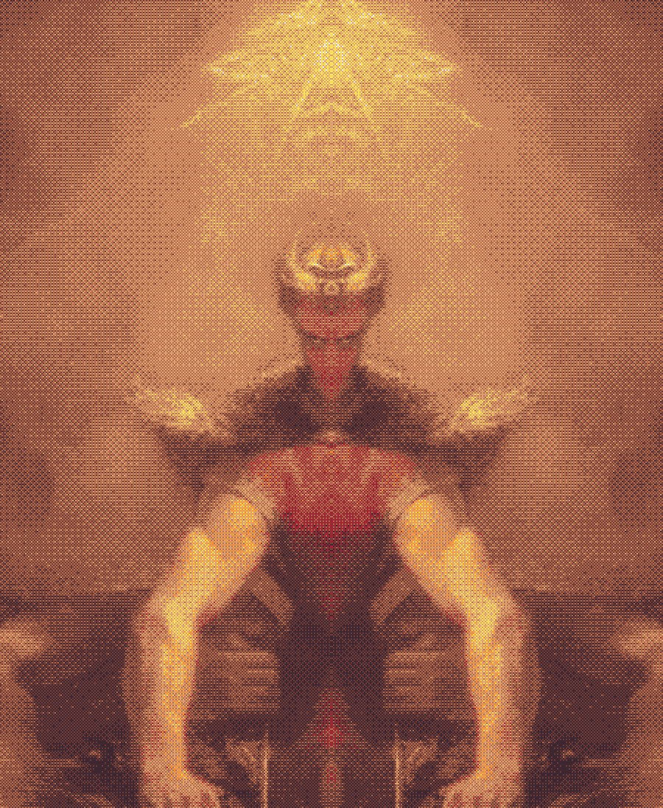](thor-kaleido-mask.png) | **`thor-kaleido-mask.png`**<br>Tor's Fight with the Giants<br>`bayer8` · `endesga-16` · pixel size 2 · crop 28%/3%/46%/38% · contrast 1.1 · brightness 1.05 · effects: kaleidoscope 30 2, scanlines 8 | bayer8 · endesga-16 · 16 colours · 900×1096<br>229 KB | Thor's strike mirrored into a kaleidoscope: a golden mask |
| [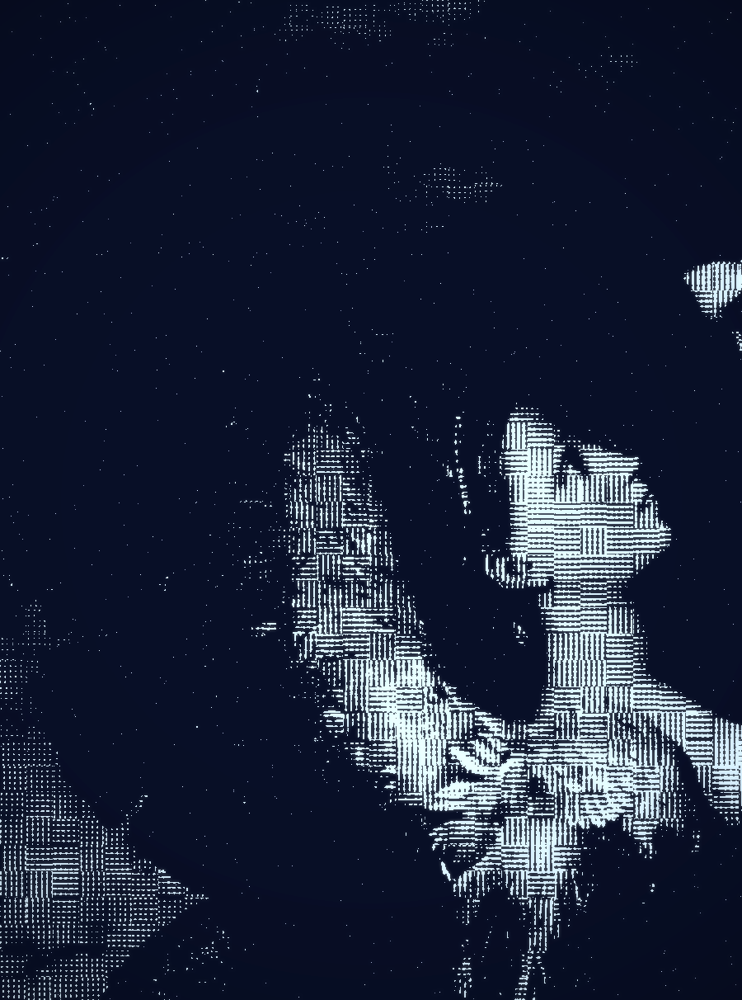](oedipus-starfield.png) | **`oedipus-starfield.png`**<br>Oedipus and the Sphinx<br>`blue-noise-32` · `ice` · pixel size 1 · crop 17%/4%/43%/88% · contrast 1.15 · effects: starfield 42 stars, vignette 28 · glow 2/25 | blue-noise-32 · ice · 2075 colours · 900×1212<br>583 KB | ice on black: the Sphinx's wing under a starfield |
| [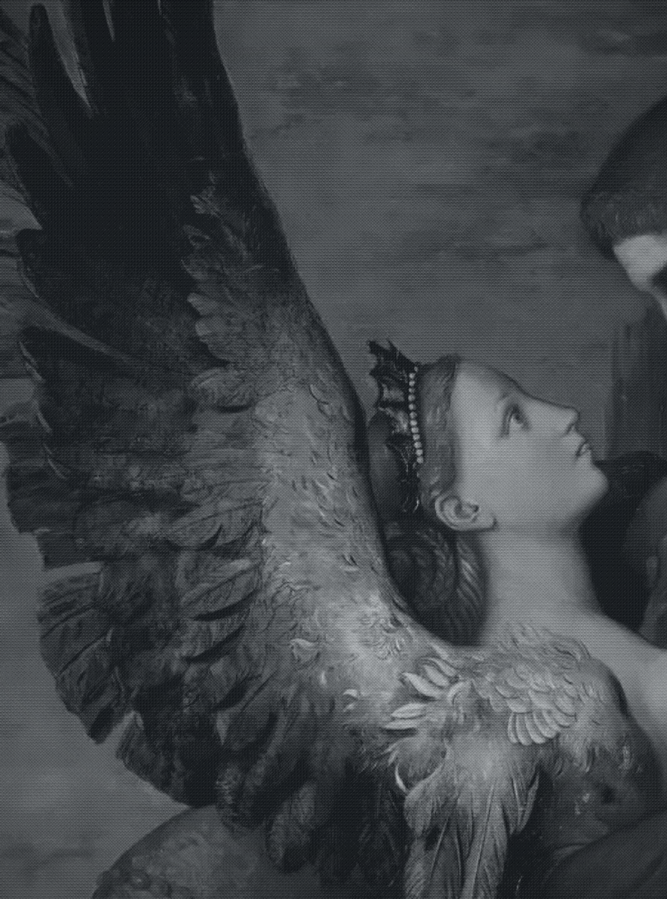](oedipus-selenium-wing.png) | **`oedipus-selenium-wing.png`**<br>Oedipus and the Sphinx<br>`bayer8` · `gray-16` · tone `selenium` · pixel size 1 · crop 17%/4%/43%/88% · contrast 1.3 · effects: vignette 30 | bayer8 · gray-16 · 623 colours · 900×1212<br>1281 KB | Selenium gives the wing a platinum-print glow |
| [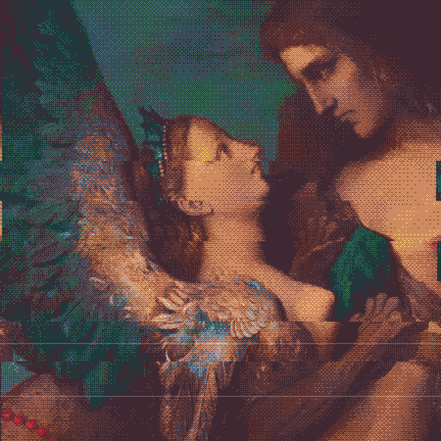](oedipus-tape-touch.png) | **`oedipus-tape-touch.png`**<br>Oedipus and the Sphinx<br>`bayer8` · `endesga-16` · pixel size 2 · crop 25%/19%/50%/75% · contrast 1.2 · saturation 1.15 · effects: tracking 32 | bayer8 · endesga-16 · 23 colours · 900×900<br>202 KB | tape tracking tears the moment of touch into horizontal bands |
| [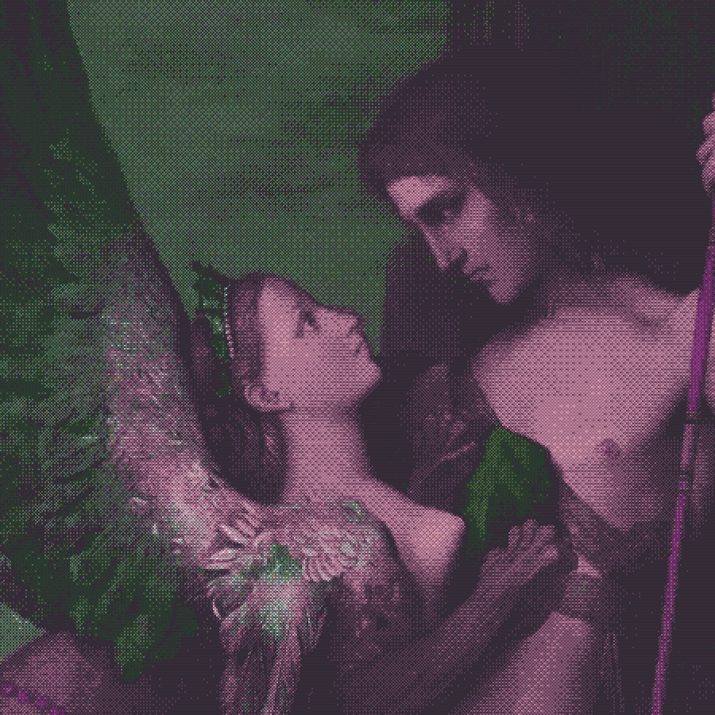](oedipus-channel-roll.png) | **`oedipus-channel-roll.png`**<br>Oedipus and the Sphinx<br>`bayer8` · `endesga-16` · pixel size 2 · crop 25%/5%/58%/88% · contrast 1.2 · saturation 1.15 · effects: channelroll 45, scanlines 8 | bayer8 · endesga-16 · 26 colours · 900×900<br>215 KB | channel roll separates the proof into green and magenta histories |
| [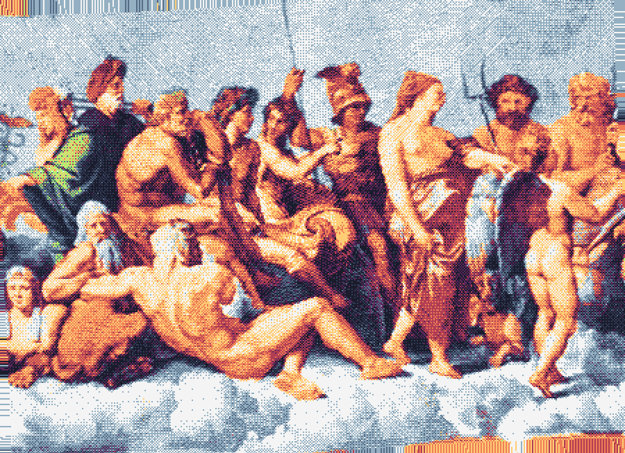](council-ripple-swirl.png) | **`council-ripple-swirl.png`**<br>The Council of the Gods<br>`bayer8` · `sweetie-16` · pixel size 2 · crop 22%/0%/56%/100% · contrast 1.2 · saturation 1.1 · effects: ripple 24 swirl | bayer8 · sweetie-16 · 10 colours · 900×653<br>158 KB | a slow swirl bends the Council's pastel court out of register |
<!-- examples:end -->

## Rebuilding them

```sh
node tools/make-examples.js                 # every picture
node tools/make-examples.js vhs text        # only the ones named
node tools/make-examples.js --list          # print the set, draw nothing
node tools/make-examples.js --width 1400    # draw bigger; 0 uses the painting's own size
```

The tool needs Playwright on the global npm root, the same way the browser checks
do — see [DEVELOPMENT.md](../DEVELOPMENT.md). It refuses to draw before it checks
every recipe against the app's own catalogues, so an algorithm, palette, tone map,
ramp or effect that does not exist fails the run and names itself; a picture in this
folder cannot claim a setting the app does not have.

Each source is cropped to its focal area and drawn to 900 px wide; the whole
folder is about 12 MB. The recipes carry no random seed, so the same run draws the
same picture twice — every file here was byte-identical on a rerun.

The generated files — `index.html`, `examples.json`, and the table above between the
`examples:begin` and `examples:end` markers — are written by that same script. Edit a
recipe in the tool and rerun it, and the page, the manifest and this list all follow.
[`tools/check-examples.js`](../tools/check-examples.js) checks the four against each
other, which is how a renamed picture gets caught before it reaches the page.

## Licence

The pictures are Dither Studio's own output from three public-domain paintings; the
app, the folder and the tool that fills it are under the repository's
[BSD 3-Clause licence](../LICENSE). The source paintings, their museums and their
terms are recorded in [SOURCES.md](../SOURCES.md).
